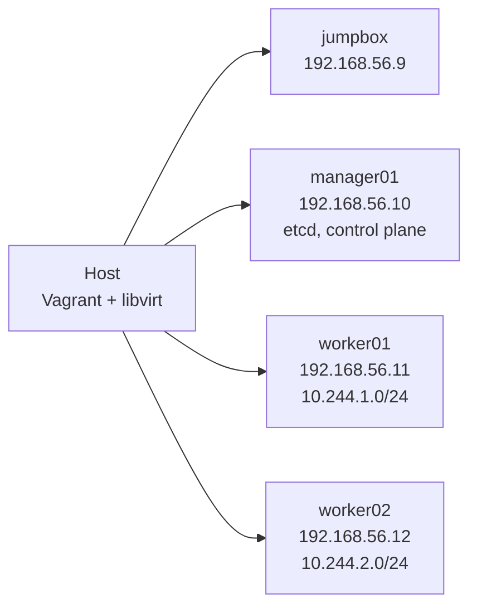

# Kubernetes The Hard Way: Vagrant + libvirt + Ansible

**English** | [Русский](README.ru.md)

A fork of Kelsey Hightower's [Kubernetes The Hard Way](https://github.com/kelseyhightower/kubernetes-the-hard-way). The original tutorial is kept as is in [`docs/`](docs). This fork adds:

- a [`Vagrantfile`](Vagrantfile) that brings up four Debian 12 VMs on libvirt/KVM;
- a step-by-step manual guide adapted to this lab, in English and Russian;
- an [Ansible playbook](ansible) that builds the same cluster automatically.

> [!WARNING]
> This is a learning lab, not a production cluster: root login with a password, etcd without TLS and the encryption key in a plain file are acceptable only here.

## Lab



| Component | Version |
| --- | --- |
| Kubernetes | v1.32.3 |
| etcd | v3.6.0-rc.3 |
| containerd | 2.1.0-beta.0 |
| runc | v1.3.0-rc.1 |
| CNI plugins | v1.6.2 |
| OS | Debian 12 (`debian/bookworm64` box) |

## Guides

| # | Guide | English | Русский |
| --- | --- | --- | --- |
| 1 | Host setup: what to install, starting the VMs | [01-host-setup](guide/en/01-host-setup.md) | [01-host-setup](guide/ru/01-host-setup.md) |
| 2 | Manual cluster build | [02-manual](guide/en/02-manual.md) | [02-manual](guide/ru/02-manual.md) |
| 3 | Ansible build | [03-ansible](guide/en/03-ansible.md) | [03-ansible](guide/ru/03-ansible.md) |

## Quick Start

```bash
git clone https://github.com/ZeroNiki/kubernetes-the-hard-way.git
cd kubernetes-the-hard-way
vagrant up --provider=libvirt

cd ansible
cp vagrant.ini.example vagrant.ini
ansible all -m ping
ansible-playbook playbook.yml
```

Host requirements and installation commands for Debian/Ubuntu, Fedora and Arch Linux are in [Host Setup](guide/en/01-host-setup.md).

## Repository Layout

| Path | Contents | Origin |
| --- | --- | --- |
| `docs/` | original tutorial chapters | upstream |
| `configs/`, `units/`, `ca.conf`, `downloads-*.txt` | config templates, systemd units, download lists | upstream |
| `Vagrantfile` | lab VMs on libvirt | this fork |
| `guide/en/`, `guide/ru/` | guides for this lab | this fork |
| `ansible/` | playbook and roles | this fork |

## Original Tutorial

The original labs are in [`docs/`](docs), starting with [Prerequisites](docs/01-prerequisites.md). They target any four machines on the same network and use different node names and addresses than this lab.

## License and Attribution

This repository is a derivative of [Kubernetes The Hard Way](https://github.com/kelseyhightower/kubernetes-the-hard-way) by Kelsey Hightower.

- The original tutorial is licensed under [CC BY-NC-SA 4.0](http://creativecommons.org/licenses/by-nc-sa/4.0/) (see [COPYRIGHT.md](COPYRIGHT.md)). The upstream repository also contains an Apache License 2.0 file ([LICENSE](LICENSE)), kept unchanged.
- The guides in `guide/` are adaptations and translations of the original tutorial and are distributed under the same [CC BY-NC-SA 4.0](http://creativecommons.org/licenses/by-nc-sa/4.0/) license.
- The `Vagrantfile` and the `ansible/` directory are distributed under the same terms. The unit templates in `ansible/roles/control-plane/templates/` and `ansible/roles/workers/templates/` are modified versions of the files in [`units/`](units) and [`configs/`](configs).

Changes from the original: libvirt/Vagrant lab, node names `manager01`/`worker01`/`worker02`, pod CIDR `10.244.0.0/16`, certificate generation with plain `openssl` commands, explicit `--advertise-address`, `--service-cluster-ip-range` and `--node-ip`, and the Ansible automation. The full list is in [Differences from the Original Tutorial](guide/en/02-manual.md#differences-from-the-original-tutorial).

This fork is not affiliated with or endorsed by the original author. Non-commercial use only.
