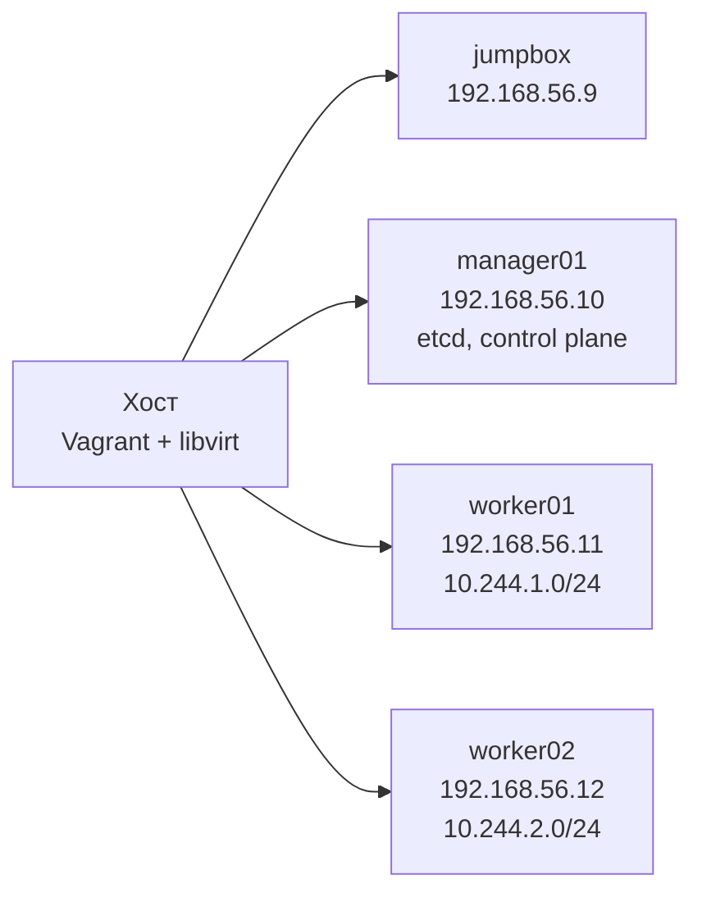

# Kubernetes The Hard Way: Vagrant + libvirt + Ansible

[English](README.md) | **Русский**

Форк [Kubernetes The Hard Way](https://github.com/kelseyhightower/kubernetes-the-hard-way) Келси Хайтауэра. Оригинальное руководство сохранено без изменений в [`docs/`](docs). Форк добавляет:

- [`Vagrantfile`](Vagrantfile), который поднимает четыре ВМ Debian 12 на libvirt/KVM;
- пошаговую инструкцию ручной сборки под этот стенд на русском и английском;
- [Ansible playbook](ansible), который собирает тот же кластер автоматически.

> [!WARNING]
> Это учебный стенд, а не промышленный кластер: вход root по паролю, etcd без TLS и ключ шифрования в открытом файле допустимы только здесь.

## Стенд



| Компонент | Версия |
| --- | --- |
| Kubernetes | v1.32.3 |
| etcd | v3.6.0-rc.3 |
| containerd | 2.1.0-beta.0 |
| runc | v1.3.0-rc.1 |
| CNI plugins | v1.6.2 |
| ОС | Debian 12 (образ `debian/bookworm64`) |

## Инструкции

| № | Инструкция | Русский | English |
| --- | --- | --- | --- |
| 1 | Подготовка хоста: что установить, запуск ВМ | [01-host-setup](guide/ru/01-host-setup.md) | [01-host-setup](guide/en/01-host-setup.md) |
| 2 | Ручная сборка кластера | [02-manual](guide/ru/02-manual.md) | [02-manual](guide/en/02-manual.md) |
| 3 | Сборка через Ansible | [03-ansible](guide/ru/03-ansible.md) | [03-ansible](guide/en/03-ansible.md) |

## Быстрый старт

```bash
git clone https://github.com/ZeroNiki/kubernetes-the-hard-way.git
cd kubernetes-the-hard-way
vagrant up --provider=libvirt

cd ansible
cp vagrant.ini.example vagrant.ini
ansible all -m ping
ansible-playbook playbook.yml
```

Требования к хосту и команды установки для Debian/Ubuntu, Fedora и Arch Linux описаны в [подготовке хоста](guide/ru/01-host-setup.md).

## Структура репозитория

| Путь | Содержимое | Происхождение |
| --- | --- | --- |
| `docs/` | главы оригинального руководства | оригинал |
| `configs/`, `units/`, `ca.conf`, `downloads-*.txt` | шаблоны конфигов, unit-файлы systemd, списки загрузки | оригинал |
| `Vagrantfile` | ВМ стенда на libvirt | этот форк |
| `guide/en/`, `guide/ru/` | инструкции для этого стенда | этот форк |
| `ansible/` | playbook и роли | этот форк |

## Оригинальное руководство

Оригинальные главы лежат в [`docs/`](docs), начиная с [Prerequisites](docs/01-prerequisites.md). Они рассчитаны на любые четыре машины в одной сети и используют другие имена нод и адреса, чем этот стенд.

## Лицензия и авторство

Репозиторий является производной работой от [Kubernetes The Hard Way](https://github.com/kelseyhightower/kubernetes-the-hard-way) Келси Хайтауэра.

- Оригинальное руководство распространяется по лицензии [CC BY-NC-SA 4.0](http://creativecommons.org/licenses/by-nc-sa/4.0/) (см. [COPYRIGHT.md](COPYRIGHT.md)). В оригинальном репозитории также есть файл лицензии Apache 2.0 ([LICENSE](LICENSE)), он сохранён без изменений.
- Инструкции в `guide/` являются адаптацией и переводом оригинального руководства и распространяются по той же лицензии [CC BY-NC-SA 4.0](http://creativecommons.org/licenses/by-nc-sa/4.0/).
- `Vagrantfile` и каталог `ansible/` распространяются на тех же условиях. Шаблоны unit-файлов в `ansible/roles/control-plane/templates/` и `ansible/roles/workers/templates/` являются изменёнными версиями файлов из [`units/`](units) и [`configs/`](configs).

Изменения относительно оригинала: стенд на libvirt/Vagrant, имена нод `manager01`/`worker01`/`worker02`, Pod CIDR `10.244.0.0/16`, генерация сертификатов отдельными командами `openssl`, явные `--advertise-address`, `--service-cluster-ip-range` и `--node-ip`, автоматизация на Ansible. Полный список - в разделе [«Отличия от оригинального руководства»](guide/ru/02-manual.md#отличия-от-оригинального-руководства).

Форк не связан с автором оригинала и не одобрен им. Только некоммерческое использование.
