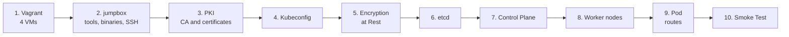
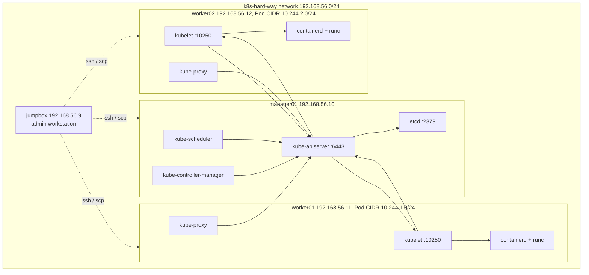
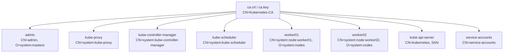
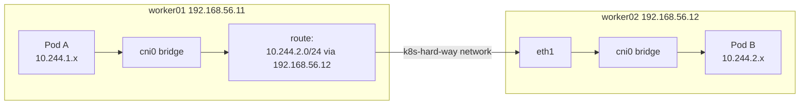
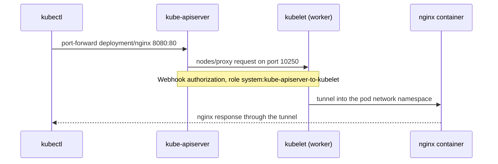

# 2. Manual Cluster Build

**English** | [Русский](../ru/02-manual.md)

A step-by-step manual build of a Kubernetes cluster without installers: four Debian virtual machines, your own certificate authority, and hand-configured etcd, control plane components and worker nodes. It is based on Kelsey Hightower's [kubernetes-the-hard-way](https://github.com/kelseyhightower/kubernetes-the-hard-way), adapted to Vagrant and libvirt. The jumpbox section follows the official [02-jumpbox](https://github.com/kelseyhightower/kubernetes-the-hard-way/blob/master/docs/02-jumpbox.md) chapter.

> [!NOTE]
> **Result**
> - A cluster with one control plane node (`manager01`) and two workers (`worker01`, `worker02`).
> - Mutual TLS authentication between all components, Node and RBAC authorization.
> - Secret encryption in etcd (`aescbc` provider).
> - Pod network on the `bridge` CNI plugin with static routing between nodes.
> - A set of smoke tests that prove the cluster works.

## Contents

- [Lab Overview and Conventions](#lab-overview-and-conventions)
- [1. Infrastructure (Vagrant)](#1-infrastructure-vagrant)
- [2. Jumpbox Setup](#2-jumpbox-setup)
- [3. TLS Certificates (PKI)](#3-tls-certificates-pki)
- [4. Kubeconfig Files](#4-kubeconfig-files)
- [5. Secret Encryption at Rest](#5-secret-encryption-at-rest)
- [6. The etcd Database](#6-the-etcd-database)
- [7. Control Plane on manager01](#7-control-plane-on-manager01)
- [8. Worker Nodes](#8-worker-nodes)
- [9. Pod Routing Between Nodes](#9-pod-routing-between-nodes)
- [10. Cluster Smoke Test](#10-cluster-smoke-test)
- [11. Troubleshooting](#11-troubleshooting)
- [Differences from the Original Tutorial](#differences-from-the-original-tutorial)
- [Links](#links)

## Lab Overview and Conventions

### Roadmap

The stages must run strictly in order: each one depends on the artifacts of the previous one (kubeconfig files need certificates, components need kubeconfig files, tests need components).



### Topology

All nodes share the libvirt network `k8s-hard-way`. Administration happens from the `jumpbox`: files are distributed and commands are run on the other machines over SSH from there. Control plane components reach the API server over loopback, the worker nodes (kubelet and kube-proxy) use `192.168.56.10`.



### Addressing

| Network | CIDR | Purpose |
| --- | --- | --- |
| Node network | `192.168.56.0/24` | libvirt network `k8s-hard-way`, VM-to-VM traffic |
| Vagrant management network | `192.168.121.0/24` | `vagrant-libvirt` network: Internet and `vagrant ssh`; the default route goes through it |
| Pod CIDR (whole cluster) | `10.244.0.0/16` | pod addresses, the `clusterCIDR` value for kube-proxy |
| Pod CIDR worker01 | `10.244.1.0/24` | pod subnet of the first worker |
| Pod CIDR worker02 | `10.244.2.0/24` | pod subnet of the second worker |
| Service CIDR | `10.32.0.0/24` | virtual service addresses (ClusterIP). `10.32.0.1` belongs to the `kubernetes` service, `10.32.0.10` is reserved for DNS |

### Component Versions

The versions come from `downloads-amd64.txt` in the repository.

| Component | Version |
| --- | --- |
| Kubernetes (kubectl, apiserver, controller-manager, scheduler, kubelet, kube-proxy) | v1.32.3 |
| etcd | v3.6.0-rc.3 |
| containerd | 2.1.0-beta.0 |
| runc | v1.3.0-rc.1 |
| CNI plugins | v1.6.2 |
| crictl | v1.32.0 |

### Ports

| Port | Component | Purpose |
| --- | --- | --- |
| `6443/tcp` | kube-apiserver | single entry point to the cluster API |
| `2379/tcp`, `2380/tcp` | etcd | client and peer traffic (listens on `127.0.0.1` only in this lab) |
| `10250/tcp` | kubelet | kubelet API: logs, exec, port-forward, metrics |
| `30000-32767/tcp` | kube-proxy | NodePort service range |

### Conventions

The first line of every code block is a marker comment that tells where to run the commands.

| Marker | Where to run |
| --- | --- |
| `# [host]` | on the host machine where Vagrant is installed |
| `# [jumpbox]` | on the jumpbox as root, from `/root/kubernetes-the-hard-way` |
| `# [manager01]` | on manager01 as root (log in with `ssh root@manager01` from the jumpbox) |

The jumpbox working directory is `/root/kubernetes-the-hard-way`. All generated files accumulate there: certificates, keys and kubeconfig files. Commands from section 2 onwards run from this directory unless stated otherwise.

> [!WARNING]
> **Lab environment.** Root SSH login with the password `root`, the CA private key on `manager01`, etcd without TLS and the encryption key in a plain file are acceptable only in a lab. Never do this in production.

## 1. Infrastructure (Vagrant)

The lab consists of four virtual machines built from the `debian/bookworm64` box and defined in the [`Vagrantfile`](../../Vagrantfile) at the repository root. Installing Vagrant and libvirt and the host requirements are covered in [Host Setup](01-host-setup.md).

| Node | Role | IP | RAM | vCPU |
| --- | --- | --- | --- | --- |
| `jumpbox` | admin workstation | `192.168.56.9` | 1.5 GB | 1 |
| `manager01` | control plane and etcd | `192.168.56.10` | 4 GB | 2 |
| `worker01` | worker node | `192.168.56.11` | 2 GB | 2 |
| `worker02` | worker node | `192.168.56.12` | 2 GB | 2 |

In total the lab uses about 9.5 GB of host RAM.

Every VM is attached to two networks: `k8s-hard-way` (`192.168.56.x`, used for node-to-node traffic) and the Vagrant management network `vagrant-libvirt` (`192.168.121.x`, used for Internet access). The default route points to the management network, so this guide explicitly gives kubelet and kube-apiserver their `192.168.56.0/24` address (sections 7.1 and 8.2).

Start the lab:

```bash
# [host]
vagrant up --provider=libvirt
vagrant status
```

> [!NOTE]
> **Expected result:** `vagrant status` shows four machines (`jumpbox`, `manager01`, `worker01`, `worker02`) in the `running` state.

## 2. Jumpbox Setup

The `jumpbox` is the admin machine, the "home base" for the build. All binaries are downloaded here (once, instead of once per node), certificates and configuration are generated here, and everything is distributed to the other machines over SSH from here. In theory any Linux or macOS machine would do, but a dedicated VM gives everyone the same environment.

### 2.1. Log In and Install Tools

Log in to the jumpbox and switch to root. All further work runs as root: it means fewer commands and no `sudo` on every line.

```bash
# [host]
vagrant ssh jumpbox
```

```bash
# [jumpbox]
sudo -i
apt-get update
apt-get -y install wget curl vim openssl git sshpass gettext-base
```

<details>
<summary>Why these packages</summary>

- `wget`, `curl` - downloading binaries and checking HTTP responses.
- `openssl` - generating keys and certificates.
- `git` - cloning the repository with configuration templates.
- `vim` - editing files.
- `sshpass` - non-interactive password input for the initial SSH key distribution (section 2.6).
- `gettext-base` - provides `envsubst`, which substitutes environment variables into the `encryption-config.yaml` template (section 5).

</details>

### 2.2. Clone the Repository

The repository contains configuration templates, systemd unit files and download lists. `--depth 1` fetches only the latest commit without history, which is faster and smaller.

```bash
# [jumpbox]
git clone --depth 1 https://github.com/ZeroNiki/kubernetes-the-hard-way.git
cd kubernetes-the-hard-way
pwd
```

> [!NOTE]
> **Expected result:** `pwd` prints `/root/kubernetes-the-hard-way`. This is the working directory for the rest of the process. If you get lost, `pwd` tells you whether you are in the right place.

### 2.3. Download the Binaries

The URL list lives in `downloads-amd64.txt` or `downloads-arm64.txt`, depending on the architecture. `dpkg --print-architecture` detects the architecture, so the commands below work on both.

```bash
# [jumpbox]
cat downloads-$(dpkg --print-architecture).txt

wget -q --show-progress \
  --https-only \
  --timestamping \
  -P downloads \
  -i downloads-$(dpkg --print-architecture).txt

ls -oh downloads
```

<details>
<summary>wget options</summary>

- `-q --show-progress` - quiet mode with a progress bar instead of a verbose log.
- `--https-only` - forbids plain HTTP, including redirects.
- `--timestamping` - does not download a file again if the local copy is not older than the remote one.
- `-P downloads` - target directory.
- `-i <file>` - reads the URL list from a file.

</details>

The download is over 500 MB; how long it takes depends on your connection.

### 2.4. Unpack and Sort the Binaries

The archives are unpacked and the binaries are sorted into per-role directories, so that they can later be copied to the nodes as a group.

```bash
# [jumpbox]
{
  ARCH=$(dpkg --print-architecture)
  mkdir -p downloads/{client,cni-plugins,controller,worker}
  tar -xvf downloads/crictl-v1.32.0-linux-${ARCH}.tar.gz \
    -C downloads/worker/
  tar -xvf downloads/containerd-2.1.0-beta.0-linux-${ARCH}.tar.gz \
    --strip-components 1 \
    -C downloads/worker/
  tar -xvf downloads/cni-plugins-linux-${ARCH}-v1.6.2.tgz \
    -C downloads/cni-plugins/
  tar -xvf downloads/etcd-v3.6.0-rc.3-linux-${ARCH}.tar.gz \
    -C downloads/ \
    --strip-components 1 \
    etcd-v3.6.0-rc.3-linux-${ARCH}/etcdctl \
    etcd-v3.6.0-rc.3-linux-${ARCH}/etcd
  mv downloads/{etcdctl,kubectl} downloads/client/
  mv downloads/{etcd,kube-apiserver,kube-controller-manager,kube-scheduler} \
    downloads/controller/
  mv downloads/{kubelet,kube-proxy} downloads/worker/
  mv downloads/runc.${ARCH} downloads/worker/runc
}

rm -rf downloads/*gz

chmod +x downloads/{client,cni-plugins,controller,worker}/*
```

<details>
<summary>Command breakdown</summary>

- `ARCH=$(dpkg --print-architecture)` - detects the architecture (`amd64` or `arm64`) and substitutes it into the archive names.
- `mkdir -p downloads/{client,cni-plugins,controller,worker}` - creates four per-role directories.
- `tar -xvf ... -C <dir>` - unpacks the archive into the given directory.
- `--strip-components 1` - drops the top-level directory inside the archive so the files land directly in the target. For etcd only the two needed files (`etcd` and `etcdctl`) are listed.
- `mv` - sorts the binaries by role; `runc.${ARCH}` is renamed to `runc`.
- `rm -rf downloads/*gz` - removes all archives (`*gz` matches both `.tar.gz` and `.tgz`). The binaries are already extracted, so later stages do not need the archives.
- `chmod +x` - makes the binaries executable. `scp` preserves the permissions.

</details>

Resulting layout:

```text
downloads/
  client/        etcdctl, kubectl
  controller/    etcd, kube-apiserver, kube-controller-manager, kube-scheduler
  worker/        containerd, containerd-shim-runc-v2, containerd-stress, ctr,
                 crictl, kubelet, kube-proxy, runc
  cni-plugins/   bridge, host-local, loopback and other plugins
```

### 2.5. Install kubectl

`kubectl` is the official Kubernetes command line client. The jumpbox needs it to generate kubeconfig files (section 4), so it is installed before the certificate work.

```bash
# [jumpbox]
cp downloads/client/kubectl /usr/local/bin/
kubectl version --client
```

> [!NOTE]
> **Expected result:** the output contains `Client Version: v1.32.3`.

### 2.6. Machine Registry and SSH Access

`machines.txt` is the single source of node data. Line format: IP address, hostname and, for worker nodes only, the pod subnet. Later commands read addresses and subnets from this file.

```bash
# [jumpbox]
cat > machines.txt <<EOF
192.168.56.9  jumpbox
192.168.56.10 manager01
192.168.56.11 worker01  10.244.1.0/24
192.168.56.12 worker02  10.244.2.0/24
EOF
```

Next, an SSH key pair is created and the public key is copied to every node, so later `ssh` and `scp` calls do not ask for a password.

```bash
# [jumpbox]
[ -f ~/.ssh/id_rsa ] || ssh-keygen -t rsa -b 4096 -N "" -f ~/.ssh/id_rsa

for node in jumpbox manager01 worker01 worker02; do
  sshpass -p root ssh-copy-id -o StrictHostKeyChecking=accept-new root@${node}
done
```

<details>
<summary>Command breakdown</summary>

- `[ -f ~/.ssh/id_rsa ] || ssh-keygen ...` - the key is created only if it does not exist yet, so a re-run does not overwrite it.
- `-t rsa -b 4096` - a 4096-bit RSA key; `-N ""` - no passphrase, required for automation.
- `sshpass -p root` - supplies the `root` password set when the VMs were created.
- `ssh-copy-id` - appends the public key to root's `~/.ssh/authorized_keys` on the target node and creates `.ssh` with correct permissions.
- `StrictHostKeyChecking=accept-new` - accepts the host fingerprint on first connect but refuses the connection if a known host's fingerprint changes. This is safer than disabling the check (`no`).

</details>

Check access and names:

```bash
# [jumpbox]
for node in jumpbox manager01 worker01 worker02; do
  ssh root@${node} hostname
done
```

> [!NOTE]
> **Expected result:** four hostnames (`jumpbox`, `manager01`, `worker01`, `worker02`) are printed without a password prompt.

> [!IMPORTANT]
> **Hostnames matter.** A worker's hostname becomes its Kubernetes node name, and it must match `CN=system:node:<name>` in the kubelet certificate (section 3). Vagrant sets the hostname from the VM name, so nothing extra is needed.

## 3. TLS Certificates (PKI)

Cluster components talk over mutually authenticated TLS (mTLS): each side presents a certificate signed by a shared certificate authority (CA). Kubernetes derives the client identity from certificate fields: `CN` (Common Name) becomes the user name and `O` (Organization) the group. RBAC works on exactly these values.



| Files | CN | O | Purpose |
| --- | --- | --- | --- |
| `ca.crt`, `ca.key` | `Kubernetes-CA` | - | root CA: signs all other certificates, `ca.crt` is used to verify them |
| `admin` | `admin` | `system:masters` | cluster administrator; `system:masters` has full access through RBAC |
| `kube-proxy` | `system:kube-proxy` | - | kube-proxy client authentication |
| `kube-controller-manager` | `system:kube-controller-manager` | - | controller-manager client authentication |
| `kube-scheduler` | `system:kube-scheduler` | - | scheduler client authentication |
| `worker01`, `worker02` | `system:node:<name>` | `system:nodes` | kubelet certificate: client (to the API) and server (port 10250); the basis of the Node Authorizer |
| `kube-api-server` | `kubernetes` | - | API server serving certificate, and client certificate when the API calls kubelets |
| `service-accounts` | `service-accounts` | - | key pair for signing and verifying ServiceAccount tokens |

### 3.1. Root Certificate Authority (CA)

Create the CA private key and a self-signed certificate. The CA is valid for 10 years, much longer than the certificates it issues (1 year); otherwise the CA would expire before its own certificates.

```bash
# [jumpbox]
openssl genrsa -out ca.key 2048

openssl req -x509 -new -key ca.key -sha256 -days 3650 \
  -subj "/CN=Kubernetes-CA" \
  -addext "basicConstraints=critical,CA:TRUE" \
  -addext "keyUsage=critical,keyCertSign,cRLSign" \
  -out ca.crt
```

<details>
<summary>Command breakdown</summary>

- `openssl genrsa -out ca.key 2048` - generates a 2048-bit RSA private key.
- `openssl req -x509` - creates a self-signed certificate in one command (instead of `req -new` followed by `x509 -signkey`).
- `-subj "/CN=Kubernetes-CA"` - sets the subject without interactive prompts.
- `basicConstraints=critical,CA:TRUE` - marks the certificate as a CA certificate.
- `keyUsage=critical,keyCertSign,cRLSign` - restricts the key to signing certificates and revocation lists.

</details>

### 3.2. Component Client Certificates

For the admin, kube-proxy, controller-manager and scheduler the procedure is identical: key, certificate signing request (CSR), signature by our CA. Only the subject differs, so a loop over a list is used.

```bash
# [jumpbox]
for entry in \
  "admin|/CN=admin/O=system:masters" \
  "kube-proxy|/CN=system:kube-proxy" \
  "kube-controller-manager|/CN=system:kube-controller-manager" \
  "kube-scheduler|/CN=system:kube-scheduler"
do
  name="${entry%%|*}"
  subj="${entry#*|}"

  openssl genrsa -out ${name}.key 2048
  openssl req -new -key ${name}.key -subj "${subj}" -out ${name}.csr
  openssl x509 -req -in ${name}.csr \
    -CA ca.crt -CAkey ca.key -CAcreateserial \
    -extfile <(printf 'basicConstraints=CA:FALSE\nkeyUsage=critical,digitalSignature,keyEncipherment\nextendedKeyUsage=clientAuth\n') \
    -out ${name}.crt -days 365
done
```

<details>
<summary>Command breakdown</summary>

- `"${entry%%|*}"` and `"${entry#*|}"` - bash parameter expansion that splits `name|subject` into two parts.
- `openssl req -new` - creates a CSR for the key.
- `openssl x509 -req -CA ca.crt -CAkey ca.key` - signs the CSR with our CA key.
- `-CAcreateserial` - keeps serial numbers in `ca.srl` automatically.
- `-extfile <(printf ...)` - passes the certificate extensions through a temporary file: not a CA, the key is for digital signatures and key encipherment, and usage is limited to client authentication (`clientAuth`).
- `O=system:masters` - the group with full RBAC rights; this is why the `admin` certificate gives full cluster access.

</details>

### 3.3. Worker Node Certificates (Node Authorizer)

Kubernetes uses a dedicated Node authorization mode: the kubelet must present a certificate with `CN=system:node:<node name>` and the group `system:nodes`. The kubelet also serves HTTPS on port 10250 and the API server verifies its certificate, so the certificate needs a `subjectAltName` (SAN) extension with the node's DNS name and IP address. The extension config is generated on the fly, the address comes from `machines.txt`.

```bash
# [jumpbox]
for host in worker01 worker02; do
  ip=$(awk -v h="${host}" '$2==h {print $1}' machines.txt)

  cat > ${host}-openssl.cnf <<EOF
[req]
req_extensions = v3_req
distinguished_name = req_distinguished_name
[req_distinguished_name]
[v3_req]
basicConstraints = CA:FALSE
extendedKeyUsage = clientAuth, serverAuth
keyUsage = critical, digitalSignature, keyEncipherment
subjectAltName = @alt_names
[alt_names]
DNS.1 = ${host}
IP.1 = ${ip}
EOF

  openssl genrsa -out ${host}.key 2048
  openssl req -new -key ${host}.key \
    -subj "/CN=system:node:${host}/O=system:nodes" \
    -config ${host}-openssl.cnf -out ${host}.csr
  openssl x509 -req -in ${host}.csr \
    -CA ca.crt -CAkey ca.key -CAcreateserial \
    -extfile ${host}-openssl.cnf -extensions v3_req \
    -out ${host}.crt -days 365

  rm ${host}-openssl.cnf
done
```

<details>
<summary>Command breakdown</summary>

- `awk -v h=... '$2==h {print $1}' machines.txt` - finds the line for the host in `machines.txt` and prints its IP address.
- `extendedKeyUsage = clientAuth, serverAuth` - the certificate is both a client certificate (kubelet calls the API) and a server certificate (the API calls the kubelet).
- `subjectAltName` - the list of valid names and addresses; without it the API server fails to verify the kubelet certificate.
- `-config ... -extfile ... -extensions v3_req` - the extensions have to be passed again when signing: `x509 -req` does not copy extensions from the CSR by default.
- `rm ${host}-openssl.cnf` - the temporary config is no longer needed.

</details>

### 3.4. API Server and Service Account Certificates

The API server certificate must be valid for every address clients use to reach it, otherwise they refuse to connect. A separate `service-accounts` key pair signs and verifies ServiceAccount tokens.

```bash
# [jumpbox]
openssl genrsa -out service-accounts.key 2048
openssl req -new -key service-accounts.key \
  -subj "/CN=service-accounts" -out service-accounts.csr
openssl x509 -req -in service-accounts.csr \
  -CA ca.crt -CAkey ca.key -CAcreateserial \
  -out service-accounts.crt -days 365

cat > kube-apiserver.cnf <<EOF
[req]
req_extensions = v3_req
distinguished_name = req_distinguished_name
[req_distinguished_name]
[v3_req]
basicConstraints = CA:FALSE
extendedKeyUsage = clientAuth, serverAuth
keyUsage = critical, digitalSignature, keyEncipherment
subjectAltName = @alt_names
[alt_names]
DNS.1 = kubernetes
DNS.2 = kubernetes.default
DNS.3 = kubernetes.default.svc
DNS.4 = kubernetes.default.svc.cluster.local
DNS.5 = manager01
IP.1 = 127.0.0.1
IP.2 = 192.168.56.10
IP.3 = 10.32.0.1
EOF

openssl genrsa -out kube-api-server.key 2048
openssl req -new -key kube-api-server.key \
  -subj "/CN=kubernetes" -config kube-apiserver.cnf -out kube-api-server.csr
openssl x509 -req -in kube-api-server.csr \
  -CA ca.crt -CAkey ca.key -CAcreateserial \
  -extfile kube-apiserver.cnf -extensions v3_req \
  -out kube-api-server.crt -days 365

rm kube-apiserver.cnf
```

<details>
<summary>What the SAN entries mean</summary>

- `kubernetes`, `kubernetes.default`, `kubernetes.default.svc`, `kubernetes.default.svc.cluster.local` - in-cluster DNS names that pods use to reach the API server.
- `manager01`, `192.168.56.10` - the control plane node name and address used by workers and the administrator.
- `127.0.0.1` - local calls from controller-manager, scheduler and kubectl on manager01.
- `10.32.0.1` - ClusterIP of the `kubernetes` service, the first address of `10.32.0.0/24`.

</details>

> [!NOTE]
> **File names.** The files are named `kube-api-server.*` (with a hyphen) because these are the paths used in the repository's `kube-apiserver.service` unit.

### 3.5. Verify the Certificates

Before distributing anything, make sure every certificate is signed by our CA and the API server certificate contains all required addresses.

```bash
# [jumpbox]
for c in admin kube-proxy kube-controller-manager kube-scheduler \
         worker01 worker02 kube-api-server service-accounts; do
  printf '%-26s' "${c}"
  openssl verify -CAfile ca.crt ${c}.crt
done

openssl x509 -in kube-api-server.crt -noout -ext subjectAltName
```

> [!NOTE]
> **Expected result:** `<name>.crt: OK` for every certificate. The API server SAN lists all DNS names and three IP addresses.

### 3.6. Prepare Directories and Distribute Certificates

The target directories are created first: `scp` does not create missing directories and fails with `No such file or directory`. Directories needed by later stages are created here as well.

```bash
# [jumpbox]
ssh root@manager01 "mkdir -p /var/lib/kubernetes /etc/kubernetes/config"

for host in worker01 worker02; do
  ssh root@${host} "mkdir -p /var/lib/kubelet /var/lib/kube-proxy /etc/cni/net.d /opt/cni/bin /etc/containerd"
done
```

Then the certificates are copied to the component directories:

```bash
# [jumpbox]
for host in worker01 worker02; do
  scp ca.crt ${host}.crt ${host}.key root@${host}:/var/lib/kubelet/
done

scp ca.crt ca.key \
  kube-api-server.crt kube-api-server.key \
  service-accounts.crt service-accounts.key \
  root@manager01:/var/lib/kubernetes/
```

<details>
<summary>What goes where</summary>

- Worker nodes: `ca.crt` (to verify the API server and clients) and the kubelet key pair in `/var/lib/kubelet/`.
- manager01: `ca.crt` and `ca.key` (controller-manager signs certificate requests with them and uses `ca.crt` as the root), the API server key pair and the `service-accounts` key pair.
- The kube-proxy, controller-manager, scheduler and admin certificates are not copied separately: they are embedded in the kubeconfig files (section 4).

</details>

## 4. Kubeconfig Files

A kubeconfig file holds everything a client needs to connect to the cluster: the API server address with the root certificate (`cluster`), the client certificate and key (`user`) and the binding between them (`context`). Each component gets its own file. Certificates are embedded into the file (`--embed-certs=true`), so the nodes do not need separate `.crt` and `.key` files.

The API server address depends on where the component runs:

| Kubeconfig | User | API server address | Why |
| --- | --- | --- | --- |
| `worker01`, `worker02` | `system:node:<name>` | `https://192.168.56.10:6443` | the kubelet runs on another machine |
| `kube-proxy` | `system:kube-proxy` | `https://192.168.56.10:6443` | kube-proxy runs on the workers |
| `kube-controller-manager` | `system:kube-controller-manager` | `https://127.0.0.1:6443` | runs on manager01 next to the API server |
| `kube-scheduler` | `system:kube-scheduler` | `https://127.0.0.1:6443` | runs on manager01 next to the API server |
| `admin` | `admin` | `https://127.0.0.1:6443` | used on manager01 |

### 4.1. Generate

The same four `kubectl config` commands repeat for every file, so they are wrapped in a function. It takes the output file name, the user name, the certificate file prefix and the API server address.

```bash
# [jumpbox]
make_kubeconfig() {
  local out="$1" user="$2" cert="$3" server="$4"

  kubectl config set-cluster kubernetes-the-hard-way \
    --certificate-authority=ca.crt \
    --embed-certs=true \
    --server="${server}" \
    --kubeconfig="${out}"

  kubectl config set-credentials "${user}" \
    --client-certificate="${cert}.crt" \
    --client-key="${cert}.key" \
    --embed-certs=true \
    --kubeconfig="${out}"

  kubectl config set-context default \
    --cluster=kubernetes-the-hard-way \
    --user="${user}" \
    --kubeconfig="${out}"

  kubectl config use-context default --kubeconfig="${out}"
}

# Worker nodes reach the API through manager01's address
for host in worker01 worker02; do
  make_kubeconfig ${host}.kubeconfig system:node:${host} ${host} https://192.168.56.10:6443
done
make_kubeconfig kube-proxy.kubeconfig system:kube-proxy kube-proxy https://192.168.56.10:6443

# manager01 components reach the API over loopback
make_kubeconfig kube-controller-manager.kubeconfig system:kube-controller-manager kube-controller-manager https://127.0.0.1:6443
make_kubeconfig kube-scheduler.kubeconfig system:kube-scheduler kube-scheduler https://127.0.0.1:6443
make_kubeconfig admin.kubeconfig admin admin https://127.0.0.1:6443
```

<details>
<summary>kubectl config commands</summary>

- `set-cluster` - registers the cluster: CA certificate and API server address.
- `set-credentials` - adds a user with a client certificate and key; `--embed-certs=true` puts their contents into the file.
- `set-context` - binds the cluster and the user into a context named `default`.
- `use-context` - makes this context the active one.
- `--kubeconfig=<file>` - writes into the given file instead of `~/.kube/config`.

</details>

Check (secret data is redacted automatically):

```bash
# [jumpbox]
kubectl config view --kubeconfig=worker01.kubeconfig --minify
```

> [!NOTE]
> **Expected result:** `server: https://192.168.56.10:6443`, user `system:node:worker01`, and the certificate fields shown as `DATA+OMITTED` or `REDACTED`.

### 4.2. Distribute the Kubeconfig Files

The node directories were created in section 3.6. The files are copied under the names the unit files and component configs expect (`kubeconfig` for kubelet and kube-proxy).

```bash
# [jumpbox]
for host in worker01 worker02; do
  scp ${host}.kubeconfig root@${host}:/var/lib/kubelet/kubeconfig
  scp kube-proxy.kubeconfig root@${host}:/var/lib/kube-proxy/kubeconfig
done

scp kube-controller-manager.kubeconfig kube-scheduler.kubeconfig admin.kubeconfig \
  root@manager01:/var/lib/kubernetes/
```

## 5. Secret Encryption at Rest

By default Secret objects are stored in etcd in plain form (base64 encoding, which is not encryption). To protect them on disk, the API server encrypts data before writing it to etcd. Encryption is described by an `EncryptionConfiguration` file.

The `configs/encryption-config.yaml` template from the repository:

```yaml
kind: EncryptionConfiguration
apiVersion: apiserver.config.k8s.io/v1
resources:
  - resources:
      - secrets
    providers:
      - aescbc:
          keys:
            - name: key1
              secret: ${ENCRYPTION_KEY}
      - identity: {}
```

Provider order matters: `aescbc` comes first and encrypts new writes. `identity` (no encryption) comes second so the API server can still read data written before encryption was enabled. `${ENCRYPTION_KEY}` is substituted during generation.

```bash
# [jumpbox]
export ENCRYPTION_KEY=$(head -c 32 /dev/urandom | base64)
envsubst < configs/encryption-config.yaml > encryption-config.yaml
chmod 600 encryption-config.yaml
scp encryption-config.yaml root@manager01:/var/lib/kubernetes/
```

<details>
<summary>Command breakdown</summary>

- `head -c 32 /dev/urandom | base64` - takes 32 random bytes from the kernel CSPRNG (256 bits, the AES-256 key length) and encodes them in Base64.
- `envsubst < template > file` - replaces `${ENCRYPTION_KEY}` in the template with the environment variable value.
- `chmod 600` - only the owner can read the key file.

</details>

> [!WARNING]
> **Encryption key.** Losing the key means losing access to all encrypted secrets, and leaking it lets anyone decrypt them. The config must be on manager01 before the API server starts: `kube-apiserver.service` points to it with `--encryption-provider-config`.

## 6. The etcd Database

etcd is a distributed key-value store that holds the entire cluster state. Its only client is the API server. The lab runs a single etcd instance on manager01 serving plain HTTP on `127.0.0.1` (`--listen-client-urls` and `--advertise-client-urls` in the unit file), so there is no TLS between the API server and etcd.

First the binaries and the unit file are copied from the jumpbox:

```bash
# [jumpbox]
scp downloads/controller/etcd downloads/client/etcdctl units/etcd.service root@manager01:~/
```

Then install and start on manager01:

```bash
# [manager01]
mkdir -p /var/lib/etcd
chmod 700 /var/lib/etcd
install -m 0755 etcd etcdctl /usr/local/bin/
cp etcd.service /etc/systemd/system/

systemctl daemon-reload
systemctl enable --now etcd
```

<details>
<summary>Command breakdown</summary>

- `mkdir -p /var/lib/etcd` and `chmod 700` - the etcd data directory; owner-only because it contains all cluster data, secrets included.
- `install -m 0755` - copies the files and makes them executable.
- `systemctl daemon-reload` - makes systemd re-read the unit files and register the new `etcd` service.
- `systemctl enable --now` - enables the service at boot and starts it immediately. With `Type=notify` the command returns once etcd reports readiness.

</details>

Check:

```bash
# [manager01]
systemctl is-active etcd
etcdctl member list --endpoints=http://127.0.0.1:2379
```

> [!NOTE]
> **Expected result:** `is-active` prints `active`. The member list has one member named `controller` in the `started` state with `http://127.0.0.1:2380` (peer) and `http://127.0.0.1:2379` (client).

> [!NOTE]
> **etcdctl API version.** Older versions needed `ETCDCTL_API=3` in front of `etcdctl`. etcd 3.6 uses v3 by default, so the variable is not needed.

## 7. Control Plane on manager01

The control plane consists of three components:

- **kube-apiserver** - the single entry point: accepts requests, checks authentication and authorization, stores state in etcd.
- **kube-controller-manager** - runs the controllers that drive the actual cluster state towards the desired one (replicas, nodes, ServiceAccount tokens and so on).
- **kube-scheduler** - picks a node for every new pod.

### 7.1. Align Addresses in the Unit Files

The repository unit files have to be aligned with the lab addressing before they are copied:

- `kube-controller-manager.service` uses the pod range `10.200.0.0/16`, while this lab uses `10.244.0.0/16`;
- `kube-apiserver.service` has no `--advertise-address`. The API server listens on `0.0.0.0` and without this flag advertises the address of the default interface, which is the management network `192.168.121.x`, not `192.168.56.10`;
- `kube-apiserver.service` has no `--service-cluster-ip-range`. The service range is set explicitly so that it matches the controller-manager and the `10.32.0.1` address in the API server certificate SAN.

```bash
# [jumpbox]
sed -i 's|10.200.0.0/16|10.244.0.0/16|' units/kube-controller-manager.service

sed -i \
  -e 's|--allow-privileged=true \\|--advertise-address=192.168.56.10 \\\n  --allow-privileged=true \\|' \
  -e 's|--service-node-port-range=30000-32767 \\|--service-cluster-ip-range=10.32.0.0/24 \\\n  --service-node-port-range=30000-32767 \\|' \
  units/kube-apiserver.service

grep -n 'cluster-cidr' units/kube-controller-manager.service
grep -nE 'advertise-address|service-cluster-ip-range' units/kube-apiserver.service
```

> [!NOTE]
> **Expected result:** `--cluster-cidr=10.244.0.0/16`, `--advertise-address=192.168.56.10` and `--service-cluster-ip-range=10.32.0.0/24`.

### 7.2. Copy the Files

```bash
# [jumpbox]
scp downloads/controller/kube-apiserver \
    downloads/controller/kube-controller-manager \
    downloads/controller/kube-scheduler \
    downloads/client/kubectl \
    units/kube-apiserver.service \
    units/kube-controller-manager.service \
    units/kube-scheduler.service \
    configs/kube-apiserver-to-kubelet.yaml \
    root@manager01:~/
```

### 7.3. Install, Configure and Start

```bash
# [manager01]
install -m 0755 kube-apiserver kube-controller-manager kube-scheduler kubectl /usr/local/bin/
cp kube-apiserver.service kube-controller-manager.service kube-scheduler.service /etc/systemd/system/
```

> [!CAUTION]
> **The kube-scheduler config file is mandatory.** `kube-scheduler.service` starts the scheduler with `--config=/etc/kubernetes/config/kube-scheduler.yaml`. If the file is missing, the service exits with `status=1/FAILURE`. Create it by hand.

```bash
# [manager01]
mkdir -p /etc/kubernetes/config

cat > /etc/kubernetes/config/kube-scheduler.yaml <<EOF
apiVersion: kubescheduler.config.k8s.io/v1
kind: KubeSchedulerConfiguration
clientConnection:
  kubeconfig: /var/lib/kubernetes/kube-scheduler.kubeconfig
leaderElection:
  leaderElect: true
EOF
```

Start the services and set up the local `kubectl`:

```bash
# [manager01]
systemctl daemon-reload
systemctl enable --now kube-apiserver kube-controller-manager kube-scheduler

mkdir -p ~/.kube
cp /var/lib/kubernetes/admin.kubeconfig ~/.kube/config
chmod 600 ~/.kube/config
```

The API server needs a few seconds to initialize. Then check the services and the API:

```bash
# [manager01]
sleep 10
systemctl is-active kube-apiserver kube-controller-manager kube-scheduler
kubectl cluster-info
kubectl get svc kubernetes
```

> [!NOTE]
> **Expected result:** `active` three times, `kubectl cluster-info` reports `Kubernetes control plane is running at https://127.0.0.1:6443`, and the `kubernetes` service has `CLUSTER-IP` `10.32.0.1`. If a service did not start, `journalctl -u <service> -e --no-pager` shows why.

### 7.4. RBAC for API Server to Kubelet Access

When a user runs `kubectl logs`, `kubectl exec` or `kubectl port-forward`, the API server calls the kubelet on the worker as the user `kubernetes` (the `CN` of its certificate). The kubelet uses Webhook authorization: it asks the API server whether the action is allowed. Without an explicit role for `kubernetes` such requests are rejected with `Forbidden`. The manifest creates a `ClusterRole` with access to `nodes/proxy`, `nodes/stats`, `nodes/log`, `nodes/spec`, `nodes/metrics` and binds it to the `kubernetes` user.

```bash
# [manager01]
kubectl apply -f kube-apiserver-to-kubelet.yaml
```

> [!NOTE]
> **Expected result:** `clusterrole.rbac.authorization.k8s.io/system:kube-apiserver-to-kubelet created` and `clusterrolebinding.rbac.authorization.k8s.io/system:kube-apiserver created`.

## 8. Worker Nodes

Every worker runs three services:

- **containerd** - the container runtime; it uses the low-level runtime `runc` to start containers.
- **kubelet** - the node agent: registers the node in the cluster and, as instructed by the API server, starts and supervises pods through containerd.
- **kube-proxy** - implements Kubernetes services: it programs iptables rules that steer traffic from service virtual addresses to pods.

All commands in this section run on the jumpbox: repeated actions are loops over both workers, and configs are generated locally (with each node's subnet from `machines.txt`) and copied to the nodes. This rules out mistakes from duplicating configs for `worker01` and `worker02` by hand.

### 8.1. Prepare the Operating System

Install dependencies, turn off swap and configure the kernel for the network bridge and kube-proxy.

```bash
# [jumpbox]
for host in worker01 worker02; do
  ssh root@${host} bash -s <<'EOF'
set -e
export DEBIAN_FRONTEND=noninteractive
apt-get update
apt-get -y install socat conntrack ipset iptables kmod

# The kubelet does not start with swap enabled by default
swapoff -a
sed -i '/\sswap\s/ s/^/#/' /etc/fstab

# Kernel module and network settings for the CNI bridge and kube-proxy (iptables)
modprobe br_netfilter
echo br_netfilter > /etc/modules-load.d/br_netfilter.conf
cat > /etc/sysctl.d/99-kubernetes.conf <<SYSCTL
net.bridge.bridge-nf-call-iptables = 1
net.bridge.bridge-nf-call-ip6tables = 1
net.ipv4.ip_forward = 1
SYSCTL
sysctl --system > /dev/null
EOF
done
```

<details>
<summary>Command breakdown</summary>

- `socat` - needed for `kubectl port-forward`.
- `conntrack` and `ipset` - used by kube-proxy for connection tracking and address sets.
- `iptables` - kube-proxy in `iptables` mode creates service rules with these tools; the Debian image usually has them already, the package is listed to be safe.
- `kmod` - provides `modprobe`, which the containerd unit calls (`ExecStartPre=/sbin/modprobe overlay`).
- `swapoff -a` and the `/etc/fstab` edit - turn swap off now and after reboot.
- `br_netfilter` - a kernel module that sends bridged traffic through iptables; without it services misbehave for pods on the same node.
- `net.ipv4.ip_forward = 1` - lets the kernel forward packets between interfaces, the basis of pod connectivity.
- `ssh ... bash -s <<'EOF'` - runs the block on the remote node; the quotes around `EOF` prevent local variable expansion.

</details>

Check:

```bash
# [jumpbox]
for host in worker01 worker02; do
  ssh root@${host} "swapon --show; lsmod | grep br_netfilter; sysctl net.ipv4.ip_forward"
done
```

> [!NOTE]
> **Expected result:** `swapon --show` prints nothing (swap is off), `br_netfilter` is loaded, `net.ipv4.ip_forward = 1`.

### 8.2. Distribute Binaries and Unit Files

The kubelet, kube-proxy, `runc` and `crictl` binaries go to `/usr/local/bin/`. The containerd binaries go to `/bin/`, the path used in `ExecStart` of `containerd.service`. Everything is already in `downloads/worker/`, the containerd archive does not need to be unpacked again.

```bash
# [jumpbox]
for host in worker01 worker02; do
  scp downloads/worker/{kubelet,kube-proxy,runc,crictl} root@${host}:/usr/local/bin/
  scp downloads/worker/{containerd,containerd-shim-runc-v2,ctr} root@${host}:/bin/
  scp downloads/cni-plugins/* root@${host}:/opt/cni/bin/
  scp units/containerd.service units/kube-proxy.service \
    root@${host}:/etc/systemd/system/
done
```

The kubelet unit file is generated per node: `--node-ip` with the node address from `machines.txt` is added to it. Without this flag the kubelet registers the node with its management network address `192.168.121.x`. The API server would then call the kubelet on that address, which is not in the kubelet certificate SAN, and `kubectl logs`, `exec` and `port-forward` would fail.

```bash
# [jumpbox]
for host in worker01 worker02; do
  ip=$(awk -v h="${host}" '$2==h {print $1}' machines.txt)

  sed "s|--kubeconfig=/var/lib/kubelet/kubeconfig \\\\|&\n  --node-ip=${ip} \\\\|" \
    units/kubelet.service > kubelet.service

  scp kubelet.service root@${host}:/etc/systemd/system/
done

grep -n 'node-ip' kubelet.service
```

> [!WARNING]
> **runc must be executable.** Permissions were set on the jumpbox (section 2.4) and `scp` preserves them, but they are set again on the node in case the flag got lost. A symlink in `/usr/bin` is also created so `containerd` always finds the runtime regardless of the service `PATH`.

```bash
# [jumpbox]
for host in worker01 worker02; do
  ssh root@${host} "chmod +x /usr/local/bin/{kubelet,kube-proxy,runc,crictl} /bin/{containerd,containerd-shim-runc-v2,ctr} \
    && ln -sf /usr/local/bin/runc /usr/bin/runc"
done
```

### 8.3. Network Plugins (CNI)

The plugins are already in `/opt/cni/bin/`. Now their configs are created in `/etc/cni/net.d/`:

- `10-bridge.conf` - the `bridge` plugin: creates the `cni0` bridge on the node, attaches pods to it and assigns addresses from the node subnet through `host-local`. `isGateway` gives the bridge the gateway address, `ipMasq` enables NAT for outgoing pod traffic, and the `0.0.0.0/0` route gives the pod a default route.
- `99-loopback.conf` - the `loopback` plugin: brings up `lo` inside every pod.

The subnet comes from `machines.txt`, so each node gets its own range.

```bash
# [jumpbox]
for host in worker01 worker02; do
  subnet=$(awk -v h="${host}" '$2==h {print $3}' machines.txt)

  cat > 10-bridge.conf <<EOF
{
  "cniVersion": "1.0.0",
  "name": "bridge",
  "type": "bridge",
  "bridge": "cni0",
  "isGateway": true,
  "ipMasq": true,
  "ipam": {
    "type": "host-local",
    "ranges": [[{"subnet": "${subnet}"}]],
    "routes": [{"dst": "0.0.0.0/0"}]
  }
}
EOF

  scp 10-bridge.conf configs/99-loopback.conf root@${host}:/etc/cni/net.d/
done
```

### 8.4. containerd Configuration

The config is generated with `containerd config default`, then `SystemdCgroup = true` is added to the `runc` runtime section. It is mandatory: the kubelet uses the `systemd` cgroup driver (`cgroupDriver: systemd`), and containerd has to use the same driver or pods will not start.

```bash
# [jumpbox]
for host in worker01 worker02; do
  ssh root@${host} bash -s <<'EOF'
set -e
mkdir -p /etc/containerd
containerd config default > /etc/containerd/config.toml
sed -i '/runtimes.runc.options\]/a\            SystemdCgroup = true' /etc/containerd/config.toml
grep -n -B1 SystemdCgroup /etc/containerd/config.toml
EOF
done
```

<details>
<summary>Why insert a line instead of replacing one</summary>

The containerd 2.1 default config has no `SystemdCgroup` line at all, so `sed 's/SystemdCgroup = false/SystemdCgroup = true/'` changes nothing. `sed '/pattern/a\text'` inserts the line right after the `[...runtimes.runc.options]` header. The repository's `configs/containerd-config.toml` uses the `version = 2` format, and containerd 2.1 warns about ignored keys when parsing it, so the default config is generated instead.

</details>

> [!NOTE]
> **Expected result:** `grep` prints the `...runtimes.runc.options]` header with `SystemdCgroup = true` right below it.

### 8.5. kubelet Configuration

Each node gets its own file: the `podCIDR` range and the certificate paths differ.

```bash
# [jumpbox]
for host in worker01 worker02; do
  subnet=$(awk -v h="${host}" '$2==h {print $3}' machines.txt)

  cat > kubelet-config.yaml <<EOF
kind: KubeletConfiguration
apiVersion: kubelet.config.k8s.io/v1beta1
authentication:
  anonymous:
    enabled: false
  webhook:
    enabled: true
  x509:
    clientCAFile: /var/lib/kubelet/ca.crt
authorization:
  mode: Webhook
cgroupDriver: systemd
clusterDomain: cluster.local
clusterDNS:
  - 10.32.0.10
containerRuntimeEndpoint: unix:///run/containerd/containerd.sock
podCIDR: ${subnet}
resolvConf: /etc/resolv.conf
runtimeRequestTimeout: "15m"
tlsCertFile: /var/lib/kubelet/${host}.crt
tlsPrivateKeyFile: /var/lib/kubelet/${host}.key
EOF

  scp kubelet-config.yaml root@${host}:/var/lib/kubelet/kubelet-config.yaml
done
```

<details>
<summary>Parameters</summary>

- `authentication.anonymous.enabled: false` - anonymous requests to the kubelet API are rejected.
- `authentication.webhook.enabled: true` and `authorization.mode: Webhook` - the kubelet checks tokens and permissions with the API server.
- `authentication.x509.clientCAFile` - client certificates are verified against our CA (this is how the API server authenticates).
- `cgroupDriver: systemd` - must match the containerd setting.
- `containerRuntimeEndpoint` - the containerd socket.
- `podCIDR` - the pod subnet of this node.
- `tlsCertFile`, `tlsPrivateKeyFile` - the certificate the kubelet serves HTTPS on port 10250 with.
- `resolvConf` - the DNS server file used to build the pods' `resolv.conf`.
- `clusterDNS` and `clusterDomain` - address and domain of the future cluster DNS.

</details>

> [!WARNING]
> **DNS inside pods.** `clusterDNS` points to `10.32.0.10`, but CoreDNS is not installed in this lab. Until it is, names do not resolve inside pods and the pod `resolv.conf` points to a DNS service that does not exist. The smoke tests are not affected (they use IP addresses). If pods need external names, remove `clusterDNS` and `clusterDomain`.

> [!NOTE]
> **resolvConf.** The kubelet default for `resolvConf` is `/etc/resolv.conf`. Change it to `/run/systemd/resolve/resolv.conf` only on systems with `systemd-resolved`, where `/etc/resolv.conf` points to the local stub `127.0.0.53`, which pods cannot use as an upstream DNS. Debian bookworm from the Vagrant box does not use `systemd-resolved`, so `/etc/resolv.conf` contains real DNS server addresses.

### 8.6. kube-proxy Configuration

Identical on both nodes. `clusterCIDR` sets the pod address range: kube-proxy treats traffic from it as internal. The `iptables` mode implements services with iptables rules.

```bash
# [jumpbox]
cat > kube-proxy-config.yaml <<EOF
kind: KubeProxyConfiguration
apiVersion: kubeproxy.config.k8s.io/v1alpha1
clientConnection:
  kubeconfig: /var/lib/kube-proxy/kubeconfig
mode: iptables
clusterCIDR: 10.244.0.0/16
EOF

for host in worker01 worker02; do
  scp kube-proxy-config.yaml root@${host}:/var/lib/kube-proxy/
done
```

### 8.7. Start the Services and Check

```bash
# [jumpbox]
for host in worker01 worker02; do
  ssh root@${host} "systemctl daemon-reload && systemctl enable --now containerd kubelet kube-proxy"
done

sleep 20
for host in worker01 worker02; do
  echo "== ${host}"
  ssh root@${host} "systemctl is-active containerd kubelet kube-proxy"
done

ssh root@manager01 kubectl get nodes -o wide
```

> [!NOTE]
> **Expected result:** `active` three times per node, and `kubectl get nodes` shows `worker01` and `worker02` as `Ready` with `INTERNAL-IP` `192.168.56.11` and `192.168.56.12` (the role is shown as `<none>`). Registration can take up to 30 seconds. If a node stays `NotReady`, see [section 11](#11-troubleshooting).

## 9. Pod Routing Between Nodes

Each worker serves its own pod subnet (`10.244.1.0/24` and `10.244.2.0/24`). Pods on `worker01` know nothing about the `worker02` subnet: a packet to `10.244.2.x` goes to the default gateway and is lost. To make it work, static routes are added on the nodes: "to reach the neighbour's pod subnet, send the packet to the neighbour's node address".



```bash
# [jumpbox]
# manager01: routes to both worker subnets
ssh root@manager01 "ip route replace 10.244.1.0/24 via 192.168.56.11 && ip route replace 10.244.2.0/24 via 192.168.56.12"

# worker01: route to the neighbour's subnet
ssh root@worker01 "ip route replace 10.244.2.0/24 via 192.168.56.12"

# worker02: route to the neighbour's subnet
ssh root@worker02 "ip route replace 10.244.1.0/24 via 192.168.56.11"
```

<details>
<summary>Command breakdown</summary>

- `ip route replace <subnet> via <gateway>` - adds an entry to the kernel routing table. Unlike `ip route add`, it does not fail if the route already exists, so it is safe to run again.
- `via 192.168.56.X` - the neighbour's address on the `k8s-hard-way` network, the next hop for the packet.
- The routes on `manager01` let the control plane reach pod addresses directly.

</details>

Check:

```bash
# [jumpbox]
ssh root@worker01 "ip route | grep 10.244"
```

> [!NOTE]
> **Expected result:** a route to `10.244.2.0/24` via `192.168.56.12`, and the local subnet `10.244.1.0/24` on the `cni0` bridge (it appears after the first pod starts).

> [!WARNING]
> **Routes are not persistent.** Routes added with `ip route` last until the VM reboots. After `vagrant reload` or a VM restart, run this section again.

## 10. Cluster Smoke Test

The smoke tests check end-to-end behaviour rather than individual services: node registration, encryption, running workloads, pod networking, proxying through the API server and services.

| # | Check | What it proves | Success criterion |
| --- | --- | --- | --- |
| 1 | Node status | nodes registered and ready | both workers are `Ready` |
| 2 | Encryption at Rest | secrets are encrypted in etcd | the `k8s:enc:aescbc:v1:key1` prefix is in etcd |
| 3 | Deployment | scheduler, kubelet and containerd work | the pod is `1/1 Running` |
| 4 | Pod connectivity | CNI and routing work (section 9) | `ping` between pods on different nodes succeeds |
| 5 | Port-forward | the API server reaches the kubelet (RBAC from 7.4) | `curl` returns `HTTP/1.1 200 OK` |
| 6 | NodePort service | kube-proxy works | the app answers on any node's port |

All tests run on **manager01**: it has `kubectl` configured (`~/.kube/config`) and etcd on `127.0.0.1`.

```bash
# [jumpbox]
ssh root@manager01
```

### Test 1. Node Status

`kubectl get nodes -o wide` shows registered nodes, their status, OS and runtime versions and internal IP addresses.

```bash
# [manager01]
kubectl get nodes -o wide
```

> [!TIP]
> **Success criterion:** both nodes are `Ready`. `INTERNAL-IP` must be `192.168.56.11` and `192.168.56.12`. If it shows `192.168.121.x` (the Vagrant management network), see [section 11](#11-troubleshooting).

### Test 2. Secret Encryption in etcd

Create a test secret and read its record directly from etcd, bypassing the API server.

```bash
# [manager01]
kubectl create secret generic kubernetes-the-hard-way --from-literal=mykey=mydata

etcdctl get /registry/secrets/default/kubernetes-the-hard-way \
  --endpoints=http://127.0.0.1:2379 | hexdump -C
```

<details>
<summary>Command breakdown</summary>

- `kubectl create secret generic` - creates a Secret from `key=value` pairs.
- `etcdctl get /registry/...` - reads the value under the key Kubernetes stores the secret at.
- `hexdump -C` - prints binary data as hex with an ASCII column, which reveals the encryption header.

</details>

> [!TIP]
> **Success criterion:** the ASCII column shows the `k8s:enc:aescbc:v1:key1` prefix, and `mydata` does not appear in plain text.

### Test 3. Deployment

`kubectl create deployment` creates a higher-level object that starts and maintains the requested number of container replicas.

```bash
# [manager01]
kubectl create deployment nginx --image=nginx
kubectl rollout status deployment/nginx --timeout=120s
kubectl get pods -l app=nginx -o wide
```

> [!TIP]
> **Success criterion:** the pod is `1/1 Running`, it has an address from one worker's subnet (`10.244.1.x` or `10.244.2.x`), and the `NODE` column shows where it runs. The first start can take a while because the image is pulled.

### Test 4. Pod Connectivity Between Nodes

Two test pods are forced onto different nodes. `spec.nodeName` in `--overrides` assigns the node directly, bypassing the scheduler. Then the first pod pings the second.

```bash
# [manager01]
kubectl run test-pod-1 --image=alpine --restart=Never \
  --overrides='{"spec": {"nodeName": "worker01"}}' -- sleep 3600
kubectl run test-pod-2 --image=alpine --restart=Never \
  --overrides='{"spec": {"nodeName": "worker02"}}' -- sleep 3600

kubectl wait --for=condition=Ready pod/test-pod-1 pod/test-pod-2 --timeout=120s

POD2_IP=$(kubectl get pod test-pod-2 -o jsonpath='{.status.podIP}')
echo "IP test-pod-2: ${POD2_IP}"
kubectl exec test-pod-1 -- ping -c 3 ${POD2_IP}
```

> [!TIP]
> **Success criterion:** `ping` finishes with `0% packet loss`. If packets are lost, check the routes from [section 9](#9-pod-routing-between-nodes).

### Test 5. Port-forward (kubectl, API Server, kubelet)

`kubectl port-forward` opens a tunnel between local port `8080` and the pod's port `80`. The request passes the whole component chain, so the test proves both the API server and API-to-kubelet access (RBAC from 7.4).



```bash
# [manager01]
kubectl port-forward deployment/nginx 8080:80 > /tmp/port-forward.log 2>&1 &
PF_PID=$!
sleep 3

curl -sI http://127.0.0.1:8080 | head -n 1

kill ${PF_PID}
```

> [!TIP]
> **Success criterion:** `HTTP/1.1 200 OK` is printed. `Forbidden` in `/tmp/port-forward.log` means the `kube-apiserver-to-kubelet.yaml` manifest was not applied (section 7.4).

> [!TIP]
> **Two terminals.** You can keep the tunnel in one terminal (`kubectl port-forward deployment/nginx 8080:80`) and run `curl http://127.0.0.1:8080` in another.

### Test 6. NodePort Service

`kubectl expose` creates a NodePort Service: kube-proxy opens a port from `30000-32767` on every node and forwards traffic to the `nginx` pods. The port is assigned automatically.

```bash
# [manager01]
kubectl expose deployment nginx --port 80 --type NodePort
kubectl get svc nginx

NODE_PORT=$(kubectl get svc nginx -o jsonpath='{.spec.ports[0].nodePort}')
echo "NodePort: ${NODE_PORT}"

curl -sI http://192.168.56.11:${NODE_PORT} | head -n 1
curl -sI http://192.168.56.12:${NODE_PORT} | head -n 1
```

> [!TIP]
> **Success criterion:** both requests return `HTTP/1.1 200 OK`: the app is reachable on any node's port, regardless of where the pod actually runs.

### Clean Up Test Resources

```bash
# [manager01]
kubectl delete service nginx
kubectl delete deployment nginx
kubectl delete pod test-pod-1 test-pod-2
kubectl delete secret kubernetes-the-hard-way
```

## 11. Troubleshooting

Generic commands to find out why any service failed:

```bash
# [any node]
systemctl status <service> --no-pager
journalctl -u <service> -e --no-pager
```

| Symptom | Likely cause | What to do |
| --- | --- | --- |
| `scp: ... No such file or directory` | the target directory does not exist | create the directories (section 3.6) |
| `kube-scheduler.service` exits with `status=1/FAILURE` | `/etc/kubernetes/config/kube-scheduler.yaml` is missing | create the file (section 7.3) and run `systemctl restart kube-scheduler` |
| a node stays `NotReady` | CNI configs missing, plugins missing or containerd not running | check `/etc/cni/net.d`, `/opt/cni/bin`, `systemctl status containerd`, `journalctl -u kubelet` |
| `FailedCreatePodSandBox` in `kubectl describe pod` | CNI error (no `bridge` or `host-local` plugin, wrong subnet) or containerd cannot find `runc` | `journalctl -u containerd -e`; check `/opt/cni/bin` and `runc` in `/usr/local/bin` and `/usr/bin` |
| pods hang in `ContainerCreating` or containers crash right away, cgroup errors in the logs | kubelet and containerd cgroup drivers differ | check `SystemdCgroup = true` (section 8.4), restart `containerd` and `kubelet` |
| `INTERNAL-IP` is `192.168.121.x` | the kubelet picked the Vagrant management network address | check `--node-ip` in `/etc/systemd/system/kubelet.service` (section 8.2), run `systemctl daemon-reload` and `systemctl restart kubelet` |
| `kubectl logs` or `exec` fail with an x509 error about `192.168.121.x` | same: the API server calls the kubelet on an address missing from the SAN | see the previous row |
| `ping` between pods on different nodes fails | routes missing or the VM was rebooted | repeat section 9 |
| `kubectl logs`, `exec`, `port-forward` return `Forbidden` | RBAC for API-to-kubelet access not applied | `kubectl apply -f kube-apiserver-to-kubelet.yaml` (section 7.4) |
| names do not resolve inside pods | CoreDNS is not installed but `clusterDNS` points to `10.32.0.10` | install CoreDNS or remove `clusterDNS` and `clusterDomain` (section 8.5) |
| a secret is readable in plain text in etcd | it was created before encryption was enabled, or the API server runs without `--encryption-provider-config` | check the API server configuration and re-create the secret |

## Differences from the Original Tutorial

| Topic | Original | This guide |
| --- | --- | --- |
| Infrastructure | any 4 machines | Vagrant + libvirt, Debian 12 (`debian/bookworm64`) |
| Node names | `server`, `node-0`, `node-1` | `manager01`, `worker01`, `worker02` |
| Pod CIDR | `10.200.0.0/16` | `10.244.0.0/16` |
| Certificates | `ca.conf` with a shared config | separate `openssl` commands per certificate group |
| kube-scheduler | config from `configs/` | config written by hand on manager01 (section 7.3) |
| containerd | `configs/containerd-config.toml` | `containerd config default` + `SystemdCgroup = true` |
| Component addresses | no explicit addresses | `--advertise-address`, `--service-cluster-ip-range` (apiserver) and `--node-ip` (kubelet), because the default route goes through the Vagrant management network |

## Links

- [Original kubernetes-the-hard-way repository](https://github.com/kelseyhightower/kubernetes-the-hard-way)
- [Video (Russian): "Устанавливаю кубер | Kubernetes The Hard Way"](https://youtu.be/HqRKOz1UBXA)
- [Kubernetes docs: cluster components](https://kubernetes.io/docs/concepts/overview/components/)
- [Kubernetes docs: PKI certificates and requirements](https://kubernetes.io/docs/setup/best-practices/certificates/)

Next: [Ansible build](03-ansible.md) - the same cluster with one command.
