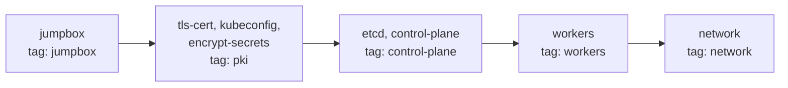

# 3. Ansible Build

**English** | [Русский](../ru/03-ansible.md)

The playbook in [`ansible/`](../../ansible) builds the same cluster as the [manual build](02-manual.md): jumpbox, PKI, kubeconfig files, secret encryption, etcd, control plane, worker nodes and pod routes. The manual path is for understanding how the cluster works. Ansible is for re-creating the lab quickly and re-running individual stages.

> [!NOTE]
> **Result:** after `ansible-playbook playbook.yml` both workers are `Ready`, and a second run finishes with `changed=0`.

## Contents

- [Requirements](#requirements)
- [Layout](#layout)
- [Roles and Stages](#roles-and-stages)
- [Variables](#variables)
- [Connecting to the VMs](#connecting-to-the-vms)
- [Running](#running)
- [Verification](#verification)
- [Differences from the Manual Build](#differences-from-the-manual-build)
- [Troubleshooting](#troubleshooting)

## Requirements

The host needs libvirt, Vagrant with the `vagrant-libvirt` plugin, Ansible and the `ansible.posix`, `community.crypto`, `community.general` collections. See [Host Setup](01-host-setup.md) for installation.

The lab has to be running:

```bash
# [host] from the repository root
vagrant up --provider=libvirt
```

All `ansible` and `ansible-playbook` commands below run from the `ansible/` directory: it contains `ansible.cfg`, which Ansible picks up from the current directory.

## Layout

```text
ansible/
├── ansible.cfg              # inventory, roles_path, pipelining, output format
├── inventory.ini            # hosts, groups, pod subnets
├── vagrant.ini.example      # template for SSH connection settings
├── requirements.yml         # Ansible collections
├── group_vars/
│   └── all.yml              # versions, cluster addressing, PKI settings
├── playbook.yml             # 6 plays, one per stage
└── roles/
    ├── jumpbox/             # tools, binaries, jumpbox SSH key
    ├── tls-cert/            # CA and certificates
    ├── kubeconfig/          # kubeconfig files
    ├── encrypt-secrets/     # encryption-config.yaml
    ├── etcd/                # etcd on manager01
    ├── control-plane/       # apiserver, controller-manager, scheduler, RBAC
    ├── workers/             # containerd, kubelet, kube-proxy, CNI
    └── network/             # pod routes
```

## Roles and Stages

As in the manual build, the jumpbox stays the central node: binaries are downloaded and certificates are generated there. The difference is that files are not pushed by whoever generated them: each role pulls what its hosts need from the jumpbox with `ansible.posix.synchronize` (rsync straight from the jumpbox to the node). This makes every role safe to re-run on its own.



| Play | Hosts | Roles | Tag | Manual build section |
| --- | --- | --- | --- | --- |
| 1 | `jump` | `jumpbox` | `jumpbox` | 2.1-2.5, the key from 2.6 |
| 2 | `all` | `jumpbox` (`tasks_from: nodes`) | `jumpbox` | 2.6: `rsync` and the jumpbox key on every node |
| 3 | `jump` | `tls-cert`, `kubeconfig`, `encrypt-secrets` | `pki` | 3, 4, 5 |
| 4 | `controllers` | `etcd`, `control-plane` | `control-plane` | 6, 7 |
| 5 | `workers` | `workers` | `workers` | 8 |
| 6 | `k8s` | `network` | `network` | 9 |

## Variables

Shared values live in [`group_vars/all.yml`](../../ansible/group_vars/all.yml), per-host values in [`inventory.ini`](../../ansible/inventory.ini).

| Variable | Value | Used by |
| --- | --- | --- |
| `k8s_version`, `etcd_version`, `containerd_version`, `runc_version`, `cni_plugins_version`, `crictl_version` | versions from `downloads-amd64.txt` | download URLs in the `jumpbox` role |
| `arch` | `amd64` | download URLs |
| `k8s_workdir` | `/root/kubernetes-the-hard-way` | working directory on the jumpbox |
| `cluster_cidr` | `10.244.0.0/16` | controller-manager, kube-proxy |
| `service_cidr`, `kubernetes_service_ip`, `cluster_dns_ip` | `10.32.0.0/24`, `10.32.0.1`, `10.32.0.10` | apiserver, certificate SAN, kubelet |
| `apiserver_host`, `apiserver_url` | derived from `ansible_host` of the first `controllers` host | worker kubeconfig files, SAN |
| `ca_validity_days`, `cert_validity_days`, `cert_key_size` | `3650`, `365`, `2048` | `tls-cert` role |
| `pod_subnet` (inventory) | `10.244.1.0/24`, `10.244.2.0/24` | CNI, kubelet, routes |

Node addresses are defined once, as `ansible_host` in the inventory. If you change them in the `Vagrantfile`, updating `inventory.ini` is enough: certificates, kubeconfig files and routes pick up the new values.

## Connecting to the VMs

SSH connection settings are not stored in the repository. Vagrant generates a separate key per VM in `.vagrant/machines/<name>/libvirt/private_key`, and the box user is `vagrant`. A template with these settings is in `vagrant.ini.example`: copy it to `vagrant.ini` (the file is in `.gitignore`).

```bash
# [host] from the ansible/ directory
cp vagrant.ini.example vagrant.ini
```

`ansible.cfg` reads the inventory from two files: `inventory.ini` (hosts) and `vagrant.ini` (connection). If your lab is not on Vagrant, put your own user and key in `vagrant.ini`.

<details>
<summary>What vagrant.ini contains</summary>

- `ansible_user=vagrant` - the user in the `debian/bookworm64` box; it gets root through `sudo` (`ansible_become=true` in the inventory).
- `ansible_ssh_private_key_file` - path to the VM key. `{{ inventory_hostname }}` expands to the host name, so every VM gets its own key.
- `ansible_ssh_common_args` - disables host key checking and storing: VM host keys change after `vagrant destroy` and `vagrant up`.

</details>

Check the connection:

```bash
# [host] from the ansible/ directory
ansible all -m ping
```

> [!NOTE]
> **Expected result:** four `SUCCESS` replies with `"ping": "pong"`.

## Running

The whole cluster with one command:

```bash
# [host] from the ansible/ directory
ansible-playbook playbook.yml
```

Or stage by stage, checking after each one:

```bash
ansible-playbook playbook.yml --tags jumpbox
ansible-playbook playbook.yml --tags pki
ansible-playbook playbook.yml --tags control-plane
ansible-playbook playbook.yml --tags workers
ansible-playbook playbook.yml --tags network
```

Before the first run it helps to check the syntax and list the tasks:

```bash
ansible-playbook playbook.yml --syntax-check
ansible-playbook playbook.yml --list-tasks
```

> [!IMPORTANT]
> The stages depend on each other just like in the manual build: `pki` needs kubectl and `python3-cryptography` from the `jumpbox` stage, `control-plane` needs the certificates from `pki`, and so on. Keep the order when running by tags.

## Verification

| Stage | Command (from `ansible/`) | Expected |
| --- | --- | --- |
| jumpbox | `ansible jump -a "ls /root/kubernetes-the-hard-way/downloads/cni-plugins"` | plugin list including `bridge` |
| jumpbox | `ansible jump -a "ssh worker01 hostname"` | `worker01`, no password prompt |
| pki | `ansible jump -m shell -a "cd /root/kubernetes-the-hard-way && openssl verify -CAfile ca.crt *.crt"` | `OK` for every certificate |
| control-plane | `ansible manager01 -a "kubectl get svc kubernetes"` | `CLUSTER-IP` `10.32.0.1` |
| workers | `ansible manager01 -a "kubectl get nodes -o wide"` | `Ready`, `INTERNAL-IP` `192.168.56.11` and `192.168.56.12` |
| network | `ansible worker01 -m shell -a "ip route \| grep 10.244"` | `10.244.2.0/24 via 192.168.56.12` |

A second `ansible-playbook playbook.yml` run should finish with `changed=0` on every host. A task that keeps reporting `changed` is not idempotent.

End-to-end smoke tests are run by hand on manager01, as in [section 10 of the manual build](02-manual.md#10-cluster-smoke-test):

```bash
# [host]
vagrant ssh manager01
sudo -i
kubectl get nodes -o wide
```

## Differences from the Manual Build

| Topic | Manual build | Ansible |
| --- | --- | --- |
| File distribution | `scp` from the jumpbox | each role pulls its files from the jumpbox with `synchronize` |
| Jumpbox SSH key | RSA 4096, distributed with `sshpass` and the root password | ed25519, installed with the `authorized_key` module, no password |
| Certificates | `openssl` commands | `community.crypto` modules: a re-run does not re-issue anything |
| Kubeconfig | `kubectl config set-*` | Jinja2 template with certificates read through `slurp` |
| Encryption key | generated every time the command runs | generated once (`creates:`), otherwise existing secrets would become unreadable |
| apiserver, controller-manager, kubelet units | `sed` edits | templates in the `control-plane` and `workers` roles, values from `group_vars` |
| containerd config | `sed` line insertion | `lineinfile`, idempotent |
| Waiting for readiness | `sleep` | `until`/`retries`: the API server via `/readyz`, nodes via the `Ready` condition |

## Troubleshooting

| Symptom | Cause | What to do |
| --- | --- | --- |
| `Unable to parse .../vagrant.ini as an inventory source` plus connection errors | `vagrant.ini` is missing | `cp vagrant.ini.example vagrant.ini` |
| `Permission denied (publickey)` | the VM was re-created, or the key path does not match where `.vagrant/` is | check `ls ../.vagrant/machines/*/libvirt/private_key` |
| `No package matching '...' is available` | the box has an empty apt index | the roles refresh the index (`update_cache: true`); check that the VMs can reach the Internet |
| an error about `jumpbox_ssh_key` when running with `--limit` | the jumpbox key is registered in the first play and needed by the second | run the `jumpbox` tag without `--limit` |
| `synchronize` fails with `Permission denied` | the node lacks the jumpbox key or `rsync` | re-run `--tags jumpbox` |
| pods on different nodes cannot reach each other after `vagrant reload` | `ip route` entries do not survive a reboot | `ansible-playbook playbook.yml --tags network` |
| a node never becomes `Ready` | see [manual build troubleshooting](02-manual.md#11-troubleshooting) | `ansible worker01 -a "journalctl -u kubelet -n 50 --no-pager"` |

Docs for the Ansible modules used in the roles:
[`ansible.posix.synchronize`](https://docs.ansible.com/ansible/latest/collections/ansible/posix/synchronize_module.html),
[`community.crypto.x509_certificate`](https://docs.ansible.com/ansible/latest/collections/community/crypto/x509_certificate_module.html),
[`community.crypto.openssl_csr`](https://docs.ansible.com/ansible/latest/collections/community/crypto/openssl_csr_module.html),
[`ansible.builtin.unarchive`](https://docs.ansible.com/ansible/latest/collections/ansible/builtin/unarchive_module.html).
