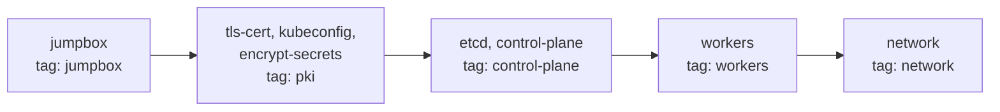

# 3. Сборка через Ansible

[English](../en/03-ansible.md) | **Русский**

Playbook из каталога [`ansible/`](../../ansible) собирает тот же кластер, что и [ручная сборка](02-manual.md): jumpbox, PKI, kubeconfig, шифрование секретов, etcd, control plane, рабочие ноды и маршруты подов. Ручной вариант нужен, чтобы понять, как устроен кластер. Ansible нужен, чтобы быстро пересоздавать стенд и повторять отдельные этапы.

> [!NOTE]
> **Результат:** после `ansible-playbook playbook.yml` обе рабочие ноды в статусе `Ready`, а повторный запуск завершается с `changed=0`.

## Содержание

- [Требования](#требования)
- [Структура](#структура)
- [Роли и этапы](#роли-и-этапы)
- [Переменные](#переменные)
- [Подключение к ВМ](#подключение-к-вм)
- [Запуск](#запуск)
- [Проверка](#проверка)
- [Отличия от ручной сборки](#отличия-от-ручной-сборки)
- [Диагностика](#диагностика)

## Требования

На хосте должны быть установлены libvirt, Vagrant с плагином `vagrant-libvirt`, Ansible и коллекции `ansible.posix`, `community.crypto`, `community.general`. Как их поставить, описано в [подготовке хоста](01-host-setup.md).

Стенд должен быть запущен:

```bash
# [host] из корня репозитория
vagrant up --provider=libvirt
```

Все команды `ansible` и `ansible-playbook` ниже выполняются из каталога `ansible/`: там лежит `ansible.cfg`, который Ansible подхватывает из текущего каталога.

## Структура

```text
ansible/
├── ansible.cfg              # inventory, roles_path, pipelining, формат вывода
├── inventory.ini            # хосты, группы, подсети подов
├── vagrant.ini.example      # шаблон параметров SSH-подключения к ВМ
├── requirements.yml         # коллекции Ansible
├── group_vars/
│   └── all.yml              # версии, адресация кластера, параметры PKI
├── playbook.yml             # 6 play, по одному на этап
└── roles/
    ├── jumpbox/             # утилиты, бинарники, SSH-ключ jumpbox
    ├── tls-cert/            # CA и сертификаты
    ├── kubeconfig/          # kubeconfig-файлы
    ├── encrypt-secrets/     # encryption-config.yaml
    ├── etcd/                # etcd на manager01
    ├── control-plane/       # apiserver, controller-manager, scheduler, RBAC
    ├── workers/             # containerd, kubelet, kube-proxy, CNI
    └── network/             # маршруты подов
```

## Роли и этапы

Как и в ручной сборке, jumpbox остаётся центральным узлом: на нём скачиваются бинарники и генерируются сертификаты. Отличие в том, что файлы не раздаёт тот, кто их сгенерировал: каждая роль сама забирает с jumpbox то, что нужно её хостам, через `ansible.posix.synchronize` (rsync с jumpbox напрямую на ноду). Поэтому любую роль можно перезапустить отдельно.



| Play | Хосты | Роли | Тег | Раздел ручной сборки |
| --- | --- | --- | --- | --- |
| 1 | `jump` | `jumpbox` | `jumpbox` | 2.1-2.5, ключ из 2.6 |
| 2 | `all` | `jumpbox` (`tasks_from: nodes`) | `jumpbox` | 2.6: `rsync` и ключ jumpbox на всех нодах |
| 3 | `jump` | `tls-cert`, `kubeconfig`, `encrypt-secrets` | `pki` | 3, 4, 5 |
| 4 | `controllers` | `etcd`, `control-plane` | `control-plane` | 6, 7 |
| 5 | `workers` | `workers` | `workers` | 8 |
| 6 | `k8s` | `network` | `network` | 9 |

## Переменные

Общие значения лежат в [`group_vars/all.yml`](../../ansible/group_vars/all.yml), значения отдельных хостов - в [`inventory.ini`](../../ansible/inventory.ini).

| Переменная | Значение | Где используется |
| --- | --- | --- |
| `k8s_version`, `etcd_version`, `containerd_version`, `runc_version`, `cni_plugins_version`, `crictl_version` | версии из `downloads-amd64.txt` | URL загрузки в роли `jumpbox` |
| `arch` | `amd64` | URL загрузки |
| `k8s_workdir` | `/root/kubernetes-the-hard-way` | рабочий каталог на jumpbox |
| `cluster_cidr` | `10.244.0.0/16` | controller-manager, kube-proxy |
| `service_cidr`, `kubernetes_service_ip`, `cluster_dns_ip` | `10.32.0.0/24`, `10.32.0.1`, `10.32.0.10` | apiserver, SAN сертификата, kubelet |
| `apiserver_host`, `apiserver_url` | вычисляются из `ansible_host` первого хоста группы `controllers` | kubeconfig рабочих нод, SAN |
| `ca_validity_days`, `cert_validity_days`, `cert_key_size` | `3650`, `365`, `2048` | роль `tls-cert` |
| `pod_subnet` (в inventory) | `10.244.1.0/24`, `10.244.2.0/24` | CNI, kubelet, маршруты |

Адреса нод задаются один раз, в `ansible_host` в inventory. Если поменять их в `Vagrantfile`, достаточно поправить `inventory.ini`: сертификаты, kubeconfig и маршруты возьмут новые значения.

## Подключение к ВМ

Параметры SSH-подключения не хранятся в репозитории. Vagrant генерирует для каждой ВМ свой ключ в `.vagrant/machines/<имя>/libvirt/private_key`, а пользователь в образе - `vagrant`. Шаблон с этими параметрами лежит в `vagrant.ini.example`: скопируйте его в `vagrant.ini` (файл в `.gitignore`).

```bash
# [host] из каталога ansible/
cp vagrant.ini.example vagrant.ini
```

`ansible.cfg` читает inventory из двух файлов: `inventory.ini` (хосты) и `vagrant.ini` (подключение). Если стенд не на Vagrant, укажите в `vagrant.ini` своего пользователя и ключ.

<details>
<summary>Что внутри vagrant.ini</summary>

- `ansible_user=vagrant` - пользователь в образе `debian/bookworm64`; права root он получает через `sudo` (`ansible_become=true` в inventory).
- `ansible_ssh_private_key_file` - путь к ключу ВМ. `{{ inventory_hostname }}` подставляет имя хоста, поэтому у каждой ВМ свой ключ.
- `ansible_ssh_common_args` - отключает проверку и сохранение host key: после `vagrant destroy` и `vagrant up` ключи ВМ меняются.

</details>

Проверка подключения:

```bash
# [host] из каталога ansible/
ansible all -m ping
```

> [!NOTE]
> **Ожидаемый результат:** четыре ответа `SUCCESS` с `"ping": "pong"`.

## Запуск

Весь кластер одной командой:

```bash
# [host] из каталога ansible/
ansible-playbook playbook.yml
```

Или по этапам, с проверкой после каждого:

```bash
ansible-playbook playbook.yml --tags jumpbox
ansible-playbook playbook.yml --tags pki
ansible-playbook playbook.yml --tags control-plane
ansible-playbook playbook.yml --tags workers
ansible-playbook playbook.yml --tags network
```

Перед первым запуском полезно проверить синтаксис и посмотреть список задач:

```bash
ansible-playbook playbook.yml --syntax-check
ansible-playbook playbook.yml --list-tasks
```

> [!IMPORTANT]
> Этапы зависят друг от друга так же, как в ручной сборке: `pki` нужен скачанный kubectl и `python3-cryptography` с этапа `jumpbox`, `control-plane` - сертификаты с этапа `pki` и так далее. При запуске по тегам соблюдайте порядок.

## Проверка

| Этап | Команда (из `ansible/`) | Ожидается |
| --- | --- | --- |
| jumpbox | `ansible jump -a "ls /root/kubernetes-the-hard-way/downloads/cni-plugins"` | список плагинов, среди них `bridge` |
| jumpbox | `ansible jump -a "ssh worker01 hostname"` | `worker01` без запроса пароля |
| pki | `ansible jump -m shell -a "cd /root/kubernetes-the-hard-way && openssl verify -CAfile ca.crt *.crt"` | `OK` у каждого сертификата |
| control-plane | `ansible manager01 -a "kubectl get svc kubernetes"` | `CLUSTER-IP` `10.32.0.1` |
| workers | `ansible manager01 -a "kubectl get nodes -o wide"` | `Ready`, `INTERNAL-IP` `192.168.56.11` и `192.168.56.12` |
| network | `ansible worker01 -m shell -a "ip route \| grep 10.244"` | `10.244.2.0/24 via 192.168.56.12` |

Повторный запуск `ansible-playbook playbook.yml` должен завершиться с `changed=0` на всех хостах. Если какая-то задача снова показывает `changed`, она неидемпотентна.

Сквозные smoke-тесты выполняются вручную на manager01, как в [разделе 10 ручной сборки](02-manual.md#10-smoke-test-кластера):

```bash
# [host]
vagrant ssh manager01
sudo -i
kubectl get nodes -o wide
```

## Отличия от ручной сборки

| Тема | Ручная сборка | Ansible |
| --- | --- | --- |
| Раздача файлов | `scp` с jumpbox | каждая роль забирает свои файлы с jumpbox через `synchronize` |
| SSH-ключ jumpbox | RSA 4096, раздаётся через `sshpass` и пароль root | ed25519, раскладывается модулем `authorized_key` без пароля |
| Сертификаты | команды `openssl` | модули `community.crypto`: повторный запуск ничего не перевыпускает |
| Kubeconfig | `kubectl config set-*` | шаблон Jinja2 с сертификатами, прочитанными через `slurp` |
| Ключ шифрования | генерируется при каждом запуске команды | генерируется один раз (`creates:`), иначе старые секреты станут нечитаемыми |
| Unit-файлы apiserver, controller-manager, kubelet | правки через `sed` | шаблоны в ролях `control-plane` и `workers` с переменными из `group_vars` |
| Конфиг containerd | `sed` с вставкой строки | `lineinfile`, идемпотентно |
| Ожидание готовности | `sleep` | `until`/`retries`: API-сервер по `/readyz`, ноды по условию `Ready` |

## Диагностика

| Симптом | Причина | Что сделать |
| --- | --- | --- |
| `Unable to parse .../vagrant.ini as an inventory source` и ошибки подключения | нет `vagrant.ini` | `cp vagrant.ini.example vagrant.ini` |
| `Permission denied (publickey)` | ВМ пересоздана, или путь к ключу не совпадает с расположением `.vagrant/` | проверить `ls ../.vagrant/machines/*/libvirt/private_key` |
| `No package matching '...' is available` | пустой индекс apt в образе | роли обновляют индекс сами (`update_cache: true`); проверьте доступ ВМ в интернет |
| ошибка про `jumpbox_ssh_key` при запуске с `--limit` | ключ jumpbox регистрируется в первом play и нужен второму | запускайте тег `jumpbox` без `--limit` |
| `synchronize` падает с `Permission denied` | на ноде нет ключа jumpbox или `rsync` | перезапустить `--tags jumpbox` |
| после `vagrant reload` поды на разных нодах не видят друг друга | маршруты `ip route` не переживают перезагрузку | `ansible-playbook playbook.yml --tags network` |
| нода не становится `Ready` | см. [диагностику ручной сборки](02-manual.md#11-диагностика-и-типичные-проблемы) | `ansible worker01 -a "journalctl -u kubelet -n 50 --no-pager"` |

Ссылки на Ansible-модули, которые используются в ролях:
[`ansible.posix.synchronize`](https://docs.ansible.com/ansible/latest/collections/ansible/posix/synchronize_module.html),
[`community.crypto.x509_certificate`](https://docs.ansible.com/ansible/latest/collections/community/crypto/x509_certificate_module.html),
[`community.crypto.openssl_csr`](https://docs.ansible.com/ansible/latest/collections/community/crypto/openssl_csr_module.html),
[`ansible.builtin.unarchive`](https://docs.ansible.com/ansible/latest/collections/ansible/builtin/unarchive_module.html).
